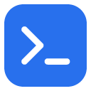
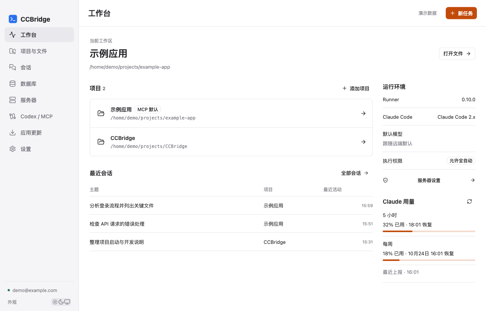
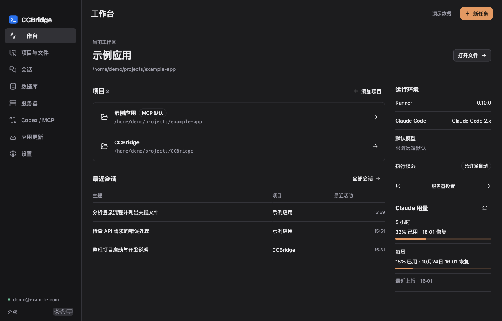

# CCBridge

### 连接远端 Claude Code 的桌面工作台

**在 Mac 上管理 SSH 项目，让 Codex 派发任务、持续对话、取回结果。**

**[下载安装](#下载安装) · [快速开始](#快速开始) · [功能特性](#功能特性) · [常见问题](#常见问题) · [使用指南](docs/USER_GUIDE.md)**

## 为什么选择 CCBridge？

代码在服务器上，Codex 在本机，Claude Code 也已经能用了——不必再来回切换终端、搬运提示词和复制执行结果。

CCBridge 用你自己的 SSH 账号连接远端，为 Codex 提供 MCP 工具，把项目、文件、Git 和 Claude 会话集中在一个应用中。

- **连上就能协作** — 在 App 登录 SSH、安装当前账号 Runner，再一键配置 Codex MCP。
- **同项目多会话分析** — 复用现有Claude登录，多条分析并行；服务端开关禁止AI修改项目文件，仍保留App人工Git与文件管理。
- **对话可以继续** — 按项目整理会话，追问沿用原会话与目录，随时查看任务状态和结果。
- **代码留在远端** — 在服务器克隆、浏览和更新仓库；一个项目可组织后端、Web 与移动端多个仓库。
- **模型从远端获取** — 下拉选择 Claude 提供的模型，展示每轮实际模型和账户额度。
- **适合日常使用** — 本机保存密码、启动连接与断线自动重连、亮暗主题和签名应用内更新。

## 界面预览

以下预览使用当前界面组件与演示数据，不包含真实服务器、账号或私有项目。

<table>
<tr>
<td align="center" width="50%"> <strong>亮色工作台</strong></td>
<td align="center" width="50%"> <strong>暗色工作台</strong></td>
</tr>
</table>

## 下载安装

### macOS

要求 **macOS 12 或更高版本**。按芯片选择安装包：

| Apple Silicon（M 系列） | Intel |
|---|---|
| [下载 ARM DMG](https://github.com/akaryc1b/CCBridge/releases/latest/download/CCBridge-macos-arm64.dmg) | [下载 Intel DMG](https://github.com/akaryc1b/CCBridge/releases/latest/download/CCBridge-macos-x86_64.dmg) |

1. 打开 DMG，将 **CCBridge.app 拖入 Applications**。
2. 从“应用程序”启动 CCBridge。
3. 后续在“应用更新”中检查、下载并安装新版本，无需重复安装 DMG。

应用未使用 Developer ID 签名或 Apple 公证，首次打开可能需要在 macOS 安全设置中允许。应用内更新使用独立签名验证，验证失败不替换当前 App。

[全部版本与备用 ZIP](https://github.com/akaryc1b/CCBridge/releases) · [更新说明](docs/release-0.10.2.md)

### 远端环境

- 当前正式包提供 **Linux x86_64 Runner**，安装在 SSH 账号 HOME 下，不需要 sudo。
- 服务器需已有可运行、已认证的 **Claude Code**；CCBridge 不复制 Claude 登录凭据。
- Windows 桌面版尚未发布，见 [后续支持计划](docs/WINDOWS_SUPPORT.md)。

## 快速开始

### 1. 连接并打开项目

在“服务器”填写主机、实际 SSH 端口、用户名和密码，核对首次连接的服务器指纹。连接后安装当前账号 Runner，再到“项目与文件”打开已有目录，或创建项目并克隆仓库。

一个项目可包含多个独立仓库，也可以只选择普通目录开展任务。

### 2. 接入 Codex

在 **“Codex / MCP → 自动写入 MCP 配置”** 完成配置，再重新加载 ccbridge MCP 或新开 Codex 会话。其他任务正在运行时，等它们结束再重载。

将 [调用规则](integration/AGENTS-snippet.md) 加入对应项目的开发约束后，可以直接说：

> 使用 Claude 分析这个项目的登录流程，只分析，不修改代码。

> 沿用刚才的 Claude 会话，继续解释错误处理。

需要手动接入或使用其他 MCP 客户端时，见 [MCP 配置与工具说明](docs/USER_GUIDE.md#接入-codex)。

### 3. 选择模型与执行模式

模型从远端列表下拉选择；选择“跟随远端默认”即可沿用服务器默认模型。后续模型变化可刷新列表，不必为此重装 App。

App 新任务默认选择全自动，需先由用户开启账号的全自动授权。MCP 调用应显式指定模式；省略模式时协议默认审批，续聊沿用原模式。

**全自动可使用该 SSH 账号的文件、命令和网络权限，工作目录不是系统沙箱。** 建议使用独立、低权限的 SSH 账号。

## 功能特性

### 连接与工作台

- SSH 密码登录、服务器指纹核对、本机密码保存与自动连接。
- 开启自动连接后，断网恢复自动重连；手动断开保持离线，认证或指纹问题需人工处理。
- 项目、最近会话、Runner / Claude 状态、默认模型与额度集中展示。
- 亮色、暗色、跟随系统；原生 Mac 窗口控制。

### 项目、文件与 Git

- 多项目、多仓库组织；目录浏览与只读文本预览。
- 新建文件 / 文件夹、重命名、移动、移入回收区与恢复；同名目标不覆盖。
- Codeup HTTPS 认证配置、已有 Git 认证复用、仓库访问检测、克隆进度。
- 分支查看、创建与切换；Git 更新仅快进，拒绝脏工作区和分叉。
- 可在 App 确认后同步认证到当前 VPS 账号，支持后续普通 `git pull`。

### Claude 会话与 MCP

- 按项目分组，支持中文搜索、重命名、归档与恢复；[会话管理说明](docs/SESSIONS.md)。
- 页头任务中心查看 Claude 与 Git 后台进度，打开绑定的原操作或核实未知结果。
- Markdown 对话、运行记录、任务状态查询和取消。
- 同会话多轮追问，目录与模式随会话保留，不随 App 浏览目录改变。
- 远端模型列表、下一轮模型选择与每轮实际模型展示。
- 通过远端 Claude 查询五小时 / 每周账户额度，显示恢复与查询时间。
- Codex MCP 自动配置；支持显式项目路由、UUID 幂等请求与增量事件。

### 项目数据库

- 一个项目映射多个 MySQL / PostgreSQL 连接，以用途别名区分。
- 分别检查运行环境、MCP 握手和数据库连接。
- 复用远端已安装的 universal-db-mcp，当前适配版本为 2.14.0，固定只读模式。

## 常见问题

### 本机代码会自动同步给 Claude 吗？

不会。Claude 读取远端目录；本机修改需提交、推送，再在服务器更新。克隆支持服务器直接获取，或使用本机认证获取后经 SSH 传输代码。

### 克隆成功后，为什么 VPS 的 `git pull` 仍缺认证？

代码与认证分别管理。若希望 VPS 终端或 Claude 直接拉取，在 App 的 Codeup 认证窗口明确确认并同步到当前 VPS；以后也可补同步，不需要重新克隆。

### 保存的密码安全吗？

密码保存在本机私有文件中，不是加密保险库；同一系统账号下的程序及管理员可能读取。首次保存会提示风险。VPS 持久认证也需要明确确认，建议使用最小权限专用令牌。

### 模型和用量是实时的吗？

模型列表直接从远端 Claude 获取，支持刷新；远端 Claude Code 需支持相应模型。用量优先通过远端 Claude 的账户额度接口查询，短时缓存 60 秒；它不是费用账单。查询不可用时明确标注失败和会话历史来源，缺数据不显示为 0%。

### 更新会中断正在运行的任务吗？

安装前保护本机写入与 Codex 等待请求，未结束时会提示具体原因。已连接 SSH 时额外检查远端任务；未连接也能更新，不需要先登录服务器。本机 App 重启不会停止远端独立任务，重连后可查询。ARM 先发布，Intel 通过后追加到同一版本，更新包按架构匹配。

## 文档与开发

- [使用指南](docs/USER_GUIDE.md)：认证、文件、会话、数据库及 MCP 的详细操作。
- [构建与发布](docs/BUILDING.md)：本地开发、隔离测试、打包与 CI/CD。
- [贡献指南](CONTRIBUTING.md)：开发约束与提交流程。
- [UI、状态与文案规范](docs/UI_GUIDELINES.md)：界面和交互的统一标准。
- [安全报告](SECURITY.md)：安全问题与凭据处理边界。

技术栈：**Rust · Tauri 2 · React · TypeScript · shadcn/ui · Radix**。不依赖 Electron。

发现问题或有功能建议，请提交 [Issue](https://github.com/akaryc1b/CCBridge/issues)；请勿上传密码、令牌或私有会话。

## 致谢

感谢 [CC Switch](https://github.com/farion1231/cc-switch) 提供桌面交互与项目展示方面的参考，以及 Tauri、shadcn/ui、Radix 等开源项目。

## 许可证

[MIT License](LICENSE)。第三方许可证见 [licenses/](licenses/)、[SHADCN-EGUI-LICENSE](SHADCN-EGUI-LICENSE) 和 [UI 第三方说明](ui/THIRD-PARTY.md)。
